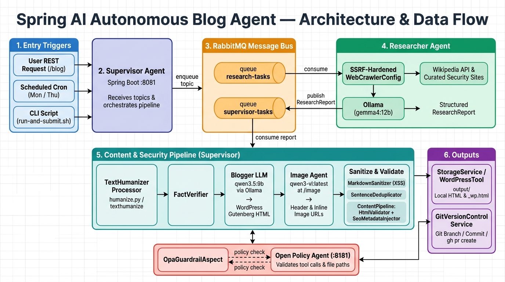
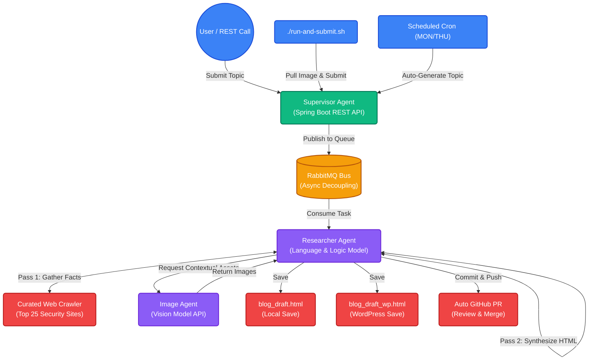

# 🤖 Spring AI Autonomous Blog Agent

     [](docs/BUILD_VERIFICATION.md)

> **Build Verification (2026-11-20):** Verified functional by **Jeffs' Automated build and deploy agent** — see [docs/BUILD_VERIFICATION.md](docs/BUILD_VERIFICATION.md).

**A highly robust, multi-agent AI system built to run complex asynchronous tasks utilizing Spring Boot and local/private Large Language Models (LLMs).**

This project demonstrates the true power of scaling robust Java application logic (Spring Boot) and asynchronous event-driven queues (RabbitMQ) with LLMs. By decoupling HTTP requests from long-running inference tasks, it achieves incredible resilience, making it perfect for pairing with powerful frontier models or private, locally-hosted LLMs (like `gemma4:12b` or `qwen3:4b`).

---

## 🚀 The Power of the Architecture

When working with LLMs, inference takes time—especially when executing a multi-pass reasoning chain that involves deep-dive web crawling, fact synthesis, and image generation. Traditional synchronous REST APIs often time out or lock up valuable threads during these operations.

**This agent solves that problem.**

By utilizing a **RabbitMQ message bus**, the system instantly accepts a large batch of research topics and frees up the HTTP thread. The specialized agents then process the tasks sequentially or in parallel without any risk of protocol timeouts.

### 🧠 Multi-Agent Microservices Workflow





### Why Specialized Agents?
Complex visual work is delegated to a separate, dedicated **Image Agent** running specific vision models (e.g., `qwen3-vl:latest`). This keeps the **Researcher Agent** focused strictly on language, analysis, and HTML drafting, drastically reducing hallucinations and formatting errors.

---

## ✨ Features
- **Asynchronous Decoupling:** Never drop a request. Send as many topics as you want; the agent works through them at its own pace.
- **Curated Web Crawling:** Pre-configured to search the top industry sites for Mobile Security, Cryptography, AppSec, and AI Security.
- **Autonomous Scheduling:** Uses Spring's `@Scheduled` annotation to run completely independently on a strict cron schedule (e.g., every Mon/Thu).
- **Java 25 Native:** Fully updated and tested against OpenJDK 25 toolchains with clean SLF4J logging and standard Java constructs.
- **WordPress & Gutenberg Ready:** Generates both a raw local draft and WordPress Gutenberg block-formatted draft with automated whitespace, carriage return, and comment tag normalization (eliminating stray line feeds and spacing errors).
- **Dynamic File Generation:** Automatically saves HTML drafts to the `output/` directory with filenames matching the requested topic (e.g., `output/ai-code-tech-debt.html`). These files are automatically synced to your host machine when running via Docker.
- **Local Application Logging:** Keeps a clean, overwritten `request-activity.log` tracing all agent interactions on every application start via a custom Logback configuration.
- **Security Hardening:** Production-ready protections against SSRF (DNS/IP range validation), Path Traversal (fail-closed normalization), and Command Injection (option separators and strict input sanitization).
- **High-Throughput Asynchronous Coordination:** The Supervisor Agent utilizes non-blocking `CompletableFuture` execution for message listening, preventing threads from blocking on slow external tasks (like image generation) and allowing concurrent task processing.

---

## 🛡️ Security & Compliance

This project prioritizes security through a multi-layered defense-in-depth architecture. Every tool call initiated by an AI agent is validated against a centralized Open Policy Agent (OPA) server and a Java-based security aspect that performs path normalization and argument flattening.

### Recent Security Audit

A comprehensive security audit was recently conducted, identifying and documenting key findings including:

- **H1: Tool Schema Fragility**: Identified risks in how tool arguments are mapped to OPA policies and currently being addressed via a schema-driven mapping approach.
- **H2: Researcher Agent SSRF**: Identified risks in web crawling logic and mitigated via egress IP blocklisting.

Detailed audit reports and Proofs of Concept (PoCs) can be found in the `security-audit/` directory.

## 🛠️ Setup & Installation

### 1. Using Pre-built Container Images
You don't need to build the application locally. Pre-built, multi-platform (`amd64` and `arm64`) images are automatically published to both Docker Hub and the GitHub Container Registry (GHCR).

**Docker Hub:**
```bash
docker pull jsoehner/spring-ai-agent:latest
```

**GitHub Container Registry (GHCR):**
```bash
docker pull ghcr.io/jsoehner/spring-ai-blog-agent:latest
```

### 2. Configuration & Settings Location
The primary settings for the agents are controlled through environment variables injected into the containers. The easiest way to configure these is by modifying the `docker-compose.yml` file.

Inside `docker-compose.yml`, you will find `environment:` blocks for each agent (`supervisor-agent`, `researcher-agent`, `image-agent`). Ensure your `.env` or local environment holds your `GITHUB_TOKEN` (required for the agent to open PRs automatically).

> [!TIP]
> **Docker Hub Pull / Rate Limit Issues:**
> If you experience issues pulling the third-party dependencies (like `rabbitmq`, `opa`, or `prometheus`) from Docker Hub due to rate limits or network restrictions, you can configure a custom registry mirror or prefix by exporting the `DOCKER_REGISTRY_PREFIX` environment variable or adding it to your `.env` file:
> ```bash
> # Use Google's public mirror for Docker Hub official images:
> export DOCKER_REGISTRY_PREFIX=mirror.gcr.io/
> 
> # Or use a local/corporate registry cache:
> export DOCKER_REGISTRY_PREFIX=my-registry.local/
> ```

> [!TIP]
> **Optional Containers (Docker Compose Profiles):**
> Non-essential containers (like `prometheus`) are marked as optional via Docker Compose profiles. They will **not** start by default when running `docker compose up`.
> To start optional services, define the `COMPOSE_PROFILES` environment variable or specify the profile on the command line:
> ```bash
> # Start with monitoring (Prometheus) enabled:
> COMPOSE_PROFILES=monitoring docker compose up -d
> ```

### 3. LLM Configuration Options
You can configure the system to use different LLM providers by adjusting the environment variables. Here are the available options depending on your setup:

#### Option A: Local LLM via Ollama (Default)
If you are running Ollama locally, use the native Ollama auto-configuration.
- **Variable:** `SPRING_AI_OLLAMA_BASE_URL=http://<your-ip>:11434`
- **Gotcha:** Do *not* append `/v1` when using the native Ollama integration.

#### Option B: Local LLM via Open-WebUI
If you are routing requests through an Open-WebUI instance.
- **Variable:** `SPRING_AI_OPENAI_BASE_URL=http://<your-ip>:8080/api`
- **Gotcha:** You *must* append `/api` to the Open-WebUI base URL. Spring AI appends the rest automatically. Omitting `/api` hits the web frontend and causes a `405 Method Not Allowed`.

#### Option C: Local LLM via OpenAI Starter pointing to Ollama
If you prefer to use the Spring AI OpenAI starter to communicate directly with Ollama.
- **Variable:** `SPRING_AI_OPENAI_BASE_URL=http://<your-ip>:11434/v1`
- **Gotcha:** You *must* explicitly include `/v1` in the URL, otherwise you will receive a `404 Not Found` error.

> [!WARNING]
> **Dependency Conflict:** If your `build.gradle` includes both `spring-ai-starter-model-ollama` and `spring-ai-starter-model-openai`, Spring will fail to start due to ambiguous `ChatModel` beans. You **must** disable one of the auto-configurations in your `docker-compose.yml` environment block. For example: 
> `SPRING_AUTOCONFIGURE_EXCLUDE=org.springframework.ai.model.openai.autoconfigure.OpenAiChatAutoConfiguration`

### 4. Running the Application
Once your `docker-compose.yml` is configured with your desired LLM endpoints and your `GITHUB_TOKEN`, you can start the system using the provided script. This script intelligently builds a local image if it detects uncommitted changes in your `src/` directory, otherwise it falls back to pulling the latest prebuilt image. It also checks if all containers are already operational and skips the environment restart if they are:

```bash
./run-and-submit.sh "AI code tech debt"
```

> **Note:** If the script times out waiting for the Supervisor Agent API, the pre-built image might be outdated. Append the `--build` flag to force it to use your local source code:
> ```bash
> ./run-and-submit.sh --build "AI code tech debt"
> ```

### 5. Watching it Work
Because the system is decoupled, your script will return a success message instantly once the topic is queued. To watch the AI "think" in real-time as it gathers facts and drafts the HTML, simply tail the logs:

```bash
docker compose logs -f researcher-agent
```

### 6. Autonomous Issue Agent (Moved)
The Autonomous Issue Agent has been extracted from this project into its own standalone repository to allow targeting any of your GitHub repositories. 

Please refer to the new project at `gh-issue-agent` on your local filesystem for standalone setup and usage.

### 7. Dependency Updates & Local Docker Verification
To keep dependencies secure and up-to-date, we scan the codebase using the `io.github.ben-manes.versions` plugin and apply updates dynamically via a Python utility script.

### 8. Trusted OSS Supply Chain Cache (Split-Horizon Setup)
This repository is configured to optionally route Maven/Gradle and PyPI dependencies through a self-hosted **Trusted OSS Harbor / Gatekeeper** cache while keeping public upstream registries (`mavenCentral()`, PyPI) as the zero-config default:
- **Local LAN**: Uses `http://oss.jsigroup.local:8080` via gitignored `.env` / `.mvn/` (avoiding NAT hairpinning).
- **GitHub Actions (WAN)**: Conditionally uses `vars.TRUSTED_OSS_CACHE_URL` (`https://jsigroup-oss.duckdns.org`) with mTLS client credentials (`OSS_MTLS_CLIENT_CERT`, `OSS_MTLS_CLIENT_KEY`).

To check and apply updates:
1. Run Gradle's dependency updates task to see available versions:
   ```bash
   ./gradlew dependencyUpdates
   ```
2. Automatically apply the recommended updates from the report using the update script:
   ```bash
   .venv/bin/python3 .github/scripts/update-dependencies.py
   ```

To verify and test dependency updates locally within the multi-agent container environment:
1. Rebuild the application containers and submit a test topic:
   ```bash
   ./run-and-submit.sh --build "AI Security"
   ```
2. Monitor runtime logs of the supervisor/researcher agents to verify correct orchestration:
   ```bash
   docker compose logs -f supervisor-agent
   ```
3. Stop and clean up the containers once verification is complete:
   ```bash
   docker compose down
   ```

---

## 📐 Architecture Decisions (ADRs) & Agent Skills

### Key Architecture Decision Records (ADRs)
- **[ADR-0032: Eliminate Trailing Adverb Padding and Restore Natural Sentence Cadence](docs/adr/README.md#index-of-architectural-decisions)** ([Full ADR](docs/adr/0032-eliminate-trailing-adverb-padding-and-restore-natural-cadence.md)) — Removes trailing adverb padding in generated prose to restore natural reading cadence.
- **[ADR-0031: Automated Nightly Dependency Updates and Unattended Auto-Merge Governance](docs/adr/README.md#index-of-architectural-decisions)** ([Full ADR](docs/adr/0031-automated-nightly-dependency-updates-and-unattended-auto-merge.md)) — Governs nightly dependency updates, build verification, and automated PR merging.
- **[ADR-0030: Automated SBOM & CBOM Supply Chain Governance and PQC Readiness](docs/adr/README.md#index-of-architectural-decisions)** ([Full ADR](docs/adr/0030-automated-sbom-cbom-supply-chain-governance.md)) — Automates SBOM/CBOM auditing and Post-Quantum Cryptography readiness scoring.
- **[ADR-0029: Consolidate Security Workflows and Retire Redundant Testing Workflow](docs/adr/README.md#index-of-architectural-decisions)** ([Full ADR](docs/adr/0029-consolidate-security-workflows-and-remove-redundant-testing-workflow.md)) — Standardizes CI security gates into a single consolidated governance workflow.

To learn more about the project's full architectural and security decision history, visit the complete ADR index in [docs/adr/README.md](docs/adr/README.md).

### Agent Skills
We maintain specialized agent skills inside the `.agents/skills/` directory. New skills can be installed using the `npx skills` tool:
- **[docker-expert](.agents/skills/docker-expert)** — Equips agents with container optimization, multi-stage build patterns, runtime execution analysis, and security hardening expertise.

---

## ⚠️ Gotchas & Troubleshooting

Here are the latest key operational gotchas to keep in mind when working with this project:

- **[Spring Boot 4.2 RabbitMQ Starter](docs/GOTCHAS.md#spring-boot-42-rabbitmq-starter):** Use `spring-boot-starter-rabbitmq` for classic RabbitMQ (AMQP 0-9-1) instead of `spring-boot-starter-amqp`.
- **[Docker Base Image Java Version Alignment](docs/GOTCHAS.md#docker-base-image-java-version-alignment):** Keep Dockerfile JDK/JRE base image tags aligned with Gradle's Java 25 toolchain.
- **[Java 25 Native Support & Logging Patterns](docs/GOTCHAS.md#java-25-native-support--logging-patterns):** Use standard SLF4J loggers and plain POJOs instead of Lombok to avoid JDK 25 annotation processing conflicts.
- **[WordPress Gutenberg Block Formatting & Whitespace Normalization](docs/GOTCHAS.md#wordpress-gutenberg-block-formatting--whitespace-normalization):** Keep WordPress block comments well-formed and single-line via `MarkdownSanitizer`.

To learn more and browse the complete list of operational gotchas, root causes, and troubleshooting workarounds, visit [docs/GOTCHAS.md](docs/GOTCHAS.md).


---

## 🤝 Human in the Loop (Contributing)
While the agent is designed to be highly autonomous—opening its own Pull Requests with finished drafts—human contributions to the core Java architecture or prompts are always welcome. Just branch off, make your tweaks to the agents, and open a PR!


## 🔐 SBOM, CBOM & PQC Governance

This repository integrates the [`jsoehner/jsi-bom-actions`](https://github.com/jsoehner/jsi-bom-actions) GitHub Action ([`.github/workflows/sbom-cbom.yml`](.github/workflows/sbom-cbom.yml)) for automated Software Bill of Materials (SBOM), Cryptographic Bill of Materials (CBOM), and Post-Quantum Cryptography (PQC) readiness auditing.

- **Latest Audit Report:** [`docs/security/CRYPTOGRAPHIC_AUDIT.md`](docs/security/CRYPTOGRAPHIC_AUDIT.md)
- **Learn More:** [jsoehner/jsi-bom-actions](https://github.com/jsoehner/jsi-bom-actions)

---

## 🛡️ Security & Cryptographic Posture
This project tracks Software & Cryptographic Bill of Materials (SBOM & CBOM) and Post-Quantum Cryptography (PQC) readiness. See the latest [Cryptographic Audit & PQC Migration Report](docs/security/CRYPTOGRAPHIC_AUDIT.md).
